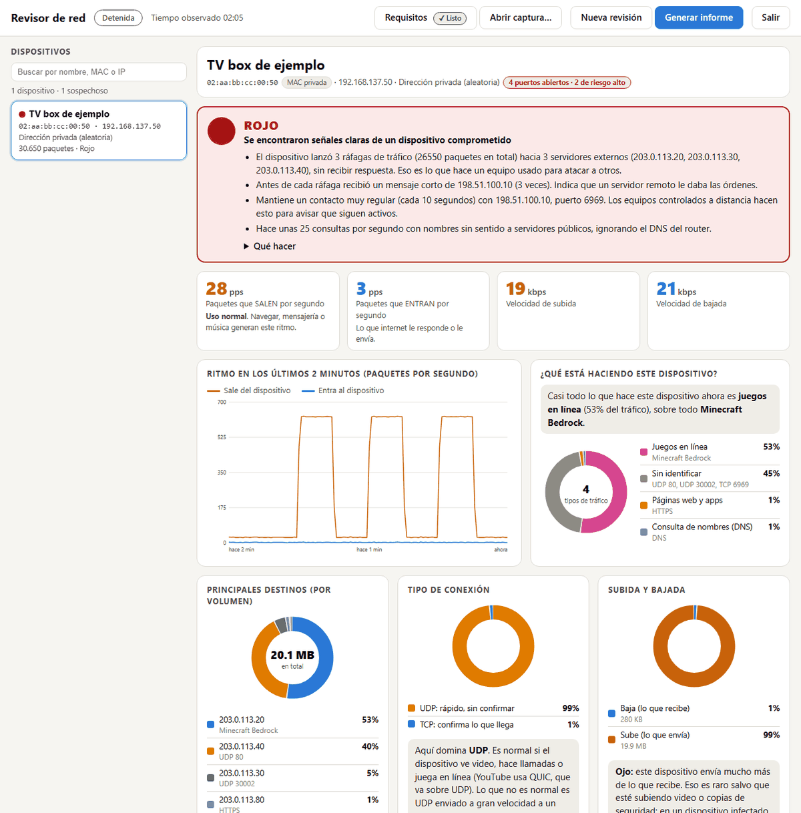
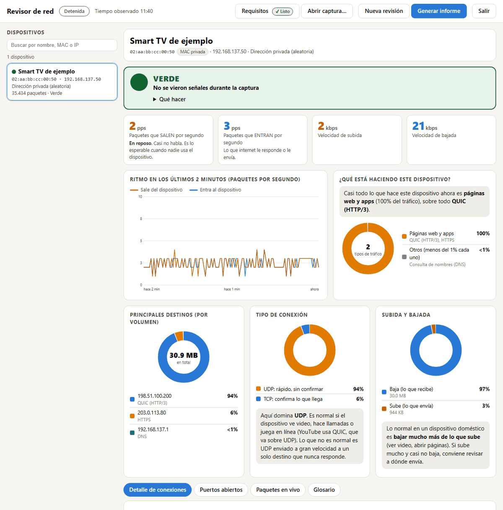
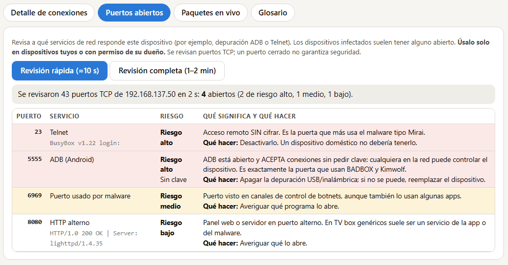
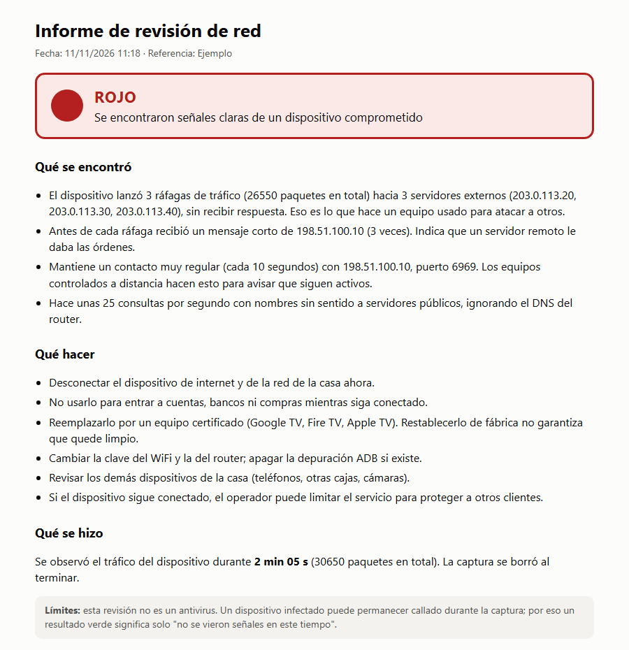
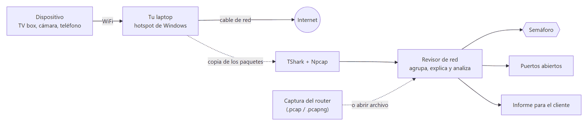

<div align="center">

# Revisor de red

### Ve en vivo qué hace un dispositivo conectado a tu red y descubre si está infectado

[](https://github.com/torvi10997/iot-botnet-lab/actions/workflows/test.yml)
[](https://github.com/torvi10997/iot-botnet-lab/actions/workflows/seguridad.yml)


</div>

**Revisor de red** (repositorio `iot-botnet-lab`) es una aplicación gratuita para **técnicos, equipos de soporte de ISP pequeños y personas con un PC** que quieren saber qué hace realmente un TV box, una cámara o un teléfono cuando se conecta a internet, y si se comporta como un **bot de una botnet DDoS**.

<p align="center">
  
</p>

<sub>**Un dispositivo que se comporta como bot:** tres ráfagas de tráfico hacia tres servidores que no responden, precedidas por órdenes de un servidor de control. Capturas con datos de ejemplo (direcciones de documentación y una MAC inventada): no muestran ninguna red real.</sub>

<details>
<summary><b>Ver cómo se ve un dispositivo normal</b></summary>



**Un dispositivo normal:** baja mucho más de lo que sube (video por QUIC) y el destino responde. El semáforo está en verde porque se observó más de 10 minutos.
</details>

---

## ¿Por qué existe?

Los dispositivos baratos y sin certificar, sobre todo los **TV box Android genéricos**, a veces salen de fábrica comprometidos. Su dueño no nota nada: el video funciona con normalidad mientras el aparato, a escondidas, recibe órdenes de un servidor remoto y **ataca a otros desde su conexión**. Para el proveedor de internet eso significa reputación dañada, reclamos de abuso y vecinos afectados.

Este proyecto nació de un caso real: un TV box con la depuración ADB abierta lanzaba inundaciones UDP a terceros desde la IP pública de un operador. La herramienta empaqueta lo aprendido para que cualquiera pueda **ver la evidencia con sus propios ojos** y **entender qué significa**.

## Qué puedes hacer con ella

- **Ver el tráfico en vivo.** Quién es el dispositivo (nombre, MAC, fabricante), con quién habla, a qué ritmo y qué tipo de tráfico produce: video, web, mensajería, publicidad, juegos...
- **Obtener un diagnóstico claro.** Un **semáforo** (rojo, amarillo, verde o no concluyente) que explica en palabras simples por qué, y qué hacer.
- **Revisar los puertos abiertos.** Distingue un ADB **abierto sin clave** (la puerta de entrada de botnets como BADBOX y Kimwolf) de uno que pide autorización.
- **Analizar capturas del router.** Carga una captura de un MikroTik u otro equipo y muestra **cientos de dispositivos a la vez, con los sospechosos primero**.
- **Entregar un informe** en lenguaje simple al cliente, imprimible, con los puertos incluidos.
- **Comprobar que todo está listo.** El botón **Requisitos** revisa Wireshark, Npcap, permisos y hotspot, y te guía para arreglar lo que falte.
- **Aprender.** Cada tipo de tráfico y cada término se explica en palabras simples, con un glosario integrado.

**Revisión de puertos abiertos**, con qué significa cada uno y qué hacer:



**Informe para el cliente**, en lenguaje simple y listo para imprimir:

<p align="center">
  
</p>

## Cómo funciona

<p align="center">
  
</p>


1. **Tu laptop actúa como punto de acceso** (el hotspot de Windows). El dispositivo se conecta a él, así que todo su tráfico pasa por tu equipo, sin tocar el router del cliente.
2. **TShark** copia los paquetes y la aplicación los lee al instante, los agrupa por dispositivo y aprende los nombres de los servidores a partir de las consultas DNS.
3. Un **analizador** busca las huellas de un bot: inundaciones UDP, SYN (TCP) e ICMP (ping) sin respuesta, órdenes de un servidor de control, latidos regulares, consultas DNS sin sentido, barridos de puertos y sondeos de la red local (buscar otros dispositivos que infectar).
4. Todo se resume en el **semáforo** y, si quieres, en un **informe**.

La aplicación **solo observa**: no ataca, no modifica el dispositivo y no envía los datos capturados a ningún servidor. Como casi todo el tráfico va cifrado, ve *quién habla con quién, cuándo y cuánto*, pero **no el contenido** de los mensajes.

## Inicio rápido

**Necesitas**, en un PC con Windows:

| Requisito | Cómo |
|---|---|
| **Python 3.8 o superior** | [python.org/downloads](https://www.python.org/downloads/). Marca **«Add Python to PATH»** al instalar |
| **Wireshark con TShark y Npcap** | [wireshark.org/download](https://www.wireshark.org/download.html). Deja marcado **TShark** y acepta instalar **Npcap** |
| **Esta herramienta** | Botón verde **Code → Download ZIP** y descomprime, o `git clone https://github.com/torvi10997/iot-botnet-lab.git` |

No usa `pip` ni instala nada más. **Después:**

1. **Enciende el hotspot** de Windows (*Configuración → Red e Internet → Zona con cobertura inalámbrica móvil*) y conecta el dispositivo que quieres revisar. Conviene que tu PC tenga internet **por cable**.
2. **Doble clic en `Abrir_app.bat`.** Se abre la ventana de la aplicación.
3. Pulsa **Iniciar captura**, pon el dispositivo en uso (por ejemplo, un video) y **deja correr 10 minutos o más**.

Si algo falta, el botón **Requisitos** te lo dice y te ayuda a resolverlo. Guía completa: [`docs/APP.md`](docs/APP.md).

<details>
<summary><b>Usarla desde la terminal</b></summary>

```bash
python -m botnet_lab app                                   # la aplicación con ventana
python -m botnet_lab app --abrir captura.pcapng            # ver una captura que ya tengas
python -m botnet_lab app --abrir captura.pcapng --gateway 192.168.88.1   # indicando la IP del router
python -m botnet_lab visita --minutos 15                   # revisar un dispositivo en consola y generar el informe
python -m botnet_lab visita --desde-captura captura.pcapng # informe de una captura existente
python -m botnet_lab analyze captura.pcapng --device 192.168.1.50   # análisis en texto o JSON (--json)
```

El código de salida es `2` si el veredicto es *sospechoso*, útil para scripts.
</details>

## Qué detecta

| Código | Indicio | Por qué importa |
|---|---|---|
| `UDP_FLOOD` | Inundación UDP sostenida (por defecto ≥ 200 paquetes/s durante ≥ 5 s) con casi ninguna respuesta | Es el ataque en sí: tráfico unidireccional hacia un tercero. Una descarga normal (video por QUIC, por ejemplo) **no** se marca, porque el destino responde |
| `SYN_FLOOD` | Cientos de aperturas de conexión por segundo (≥ 100 durante ≥ 5 s) hacia **un mismo servicio**, con casi ningún SYN-ACK | Es la inundación TCP más común. Si el servidor acepta las conexiones (carga normal) o los SYN van a muchos puertos distintos (un barrido), **no** se marca |
| `ICMP_FLOOD` | Pings sostenidos (≥ 50 por segundo durante ≥ 5 s) hacia un mismo destino | Un ping normal es 1 por segundo. Aunque el destino responda, a ese ritmo es una inundación (se baja la gravedad, no se ignora) |
| `C2_ORDER` | Un mensaje pequeño entrante justo antes (≤ 2 s) de que empiece la inundación | Delata al servidor de control que da la orden |
| `BEACON` | Mensajes del mismo tamaño a intervalos regulares hacia un mismo destino | Latido del canal de control. En los puertos 80 y 443 solo se informa |
| `DNS_RANDOM` | Consultas DNS con etiquetas largas y aleatorias (incluso binarias) directo a resolvers públicos | Sondeo de dominios del malware |
| `DNS_BYPASS` | El dispositivo ignora el DNS del router | Informativo; muchos dispositivos lo hacen |
| `SCAN` | Muchos destinos y puertos distintos con SYN en pocos segundos | Búsqueda de nuevas víctimas |
| `LAN_SCAN` | SYN hacia **20 o más equipos distintos de la misma red local** en 10 s (anota los puertos y cuántos contestaron) | Movimiento lateral: un bot busca otros dispositivos de la casa (cámaras, TV, celulares) para infectarlos. Es amarillo, no rojo, porque un escáner de red legítimo (Fing, monitoreo) se ve igual |

Lo fuerte es la **combinación**: un latido por sí solo suele ser un falso positivo (notificaciones, apps), pero latido + orden + inundación casi nunca lo es. Ejemplo de resultado (direcciones de documentación):

```
[ALTA] Inundación UDP desde 192.168.137.50 hacia 203.0.113.20:19132  (UDP_FLOOD)
    8850 paquetes en ~15 s (pico 600 pps, promedio 1190 B de datos), respuestas: 0%.
[ALTA] Orden de control 198.51.100.10:6969 seguida de inundación a 203.0.113.20  (C2_ORDER)
    Llegó un mensaje de 54 bytes 0.25 s antes de que empezara la inundación.
[MEDIA] Latido periódico 192.168.137.50 -> 198.51.100.10:6969  (BEACON)
Veredicto: SOSPECHOSO
```

Los umbrales se ajustan con `--min-pps`, `--min-secs` y `--local-net`.

## ¿Para quién es?

- **Técnicos y soportes de ISP:** confirmar con evidencia si un cliente tiene un dispositivo infectado antes de contactarlo, y entregarle un informe que entienda. Guía de visita en [`docs/VISITA.md`](docs/VISITA.md) y reglas para MikroTik en [`docs/MIKROTIK.md`](docs/MIKROTIK.md).
- **Personas con un PC:** revisar el TV box o la cámara que compraron barato.
- **Docentes y estudiantes:** una forma visible y concreta de entender qué produce un dispositivo cuando se conecta a una red.

## Documentación

| Guía | Para qué |
|---|---|
| [`docs/APP.md`](docs/APP.md) | **Guía completa:** cómo funciona, uso paso a paso, qué muestra cada parte de la pantalla, puertos, límites y solución de problemas |
| [`docs/VISITA.md`](docs/VISITA.md) | Guía del técnico para revisar un dispositivo en casa del cliente |
| [`docs/CAPTURA.md`](docs/CAPTURA.md) | Cómo capturar el tráfico de un dispositivo (hotspot, tshark) |
| [`docs/MIKROTIK.md`](docs/MIKROTIK.md) | Reglas de ejemplo para detectar y bloquear en RouterOS 7 |
| [`docs/RESPUESTA.md`](docs/RESPUESTA.md) | Qué hacer cuando encuentras uno: cliente, ISP, reporte |
| [`docs/SEGURIDAD.md`](docs/SEGURIDAD.md) | Qué se revisó de la seguridad de la aplicación, qué se encontró y qué límites quedan |

## Seguridad y privacidad

- La ventana es una página **local** (`127.0.0.1`) protegida por un **secreto de sesión**: otro programa, otro usuario del PC o una página web abierta en tu navegador no pueden usarla.
- Frente a un dispositivo hostil tiene **límites de memoria**, y los datos de la red se muestran siempre como texto, nunca como código.
- Cada cambio pasa **pruebas automáticas, Bandit y CodeQL**. La revisión de seguridad la hizo el autor con pruebas de ataque; **no es una auditoría de terceros**. Detalle en [`docs/SEGURIDAD.md`](docs/SEGURIDAD.md).
- ¿Encontraste una vulnerabilidad? Repórtala en privado como indica [`SECURITY.md`](SECURITY.md).

## Límites y uso responsable

- **No es un antivirus ni un sistema de detección de intrusos.** Un *verde* significa «no se vieron señales en este tiempo», no «está limpio»: un dispositivo infectado puede estar callado un buen rato. Por eso la herramienta nunca da verde con menos de 10 minutos de captura.
- **Un solo caso real de calibración** (un TV box genérico infectado y un teléfono sano). Con otros dispositivos pueden aparecer falsos positivos o pasar algo por alto. Si lo pruebas, abre un *issue* con tus resultados anonimizados.
- Solo **IPv4** (TCP, UDP e ICMP). No detecta inundaciones ACK/RST ni de aplicación sobre HTTPS, ni minería de criptomonedas. Un dispositivo hecho para evadir (tráfico muy bajo y lento) puede no ser detectado.
- Las capturas `.pcap`/`.pcapng` se leen si son Ethernet (con una etiqueta VLAN como máximo), Linux cooked o IP crudo. **Una captura de un router con PPPoE o con doble VLAN (QinQ) no se lee** y la app mostrará 0 dispositivos; hoy no está soportado. El hotspot de Windows no tiene este límite.
- La captura en vivo con hotspot es para **Windows**; el análisis de capturas funciona en cualquier sistema con Python.
- **Captura únicamente redes y dispositivos propios o con autorización expresa** de su dueño, y avísale antes. No publiques capturas ni informes reales sin quitar IP, MAC y datos personales.

## Desarrollo

```bash
python -m unittest discover -s tests -v    # más de 60 pruebas automáticas
```

Las pruebas usan un generador de tráfico sintético interno (`tests/emulador_pruebas.py`); no forma parte de la herramienta. El código es Python estándar, sin dependencias, repartido en `botnet_lab/` (servidor y estado en vivo, analizador, lector de capturas, revisión de puertos, requisitos e informe) más la interfaz en `botnet_lab/web/`.

**Ideas bienvenidas:** detección de más familias de bots, soporte IPv6, reglas para otros routers (OpenWrt, pfSense, Ubiquiti), prueba de reposo guiada y traducciones. Abre un *issue* o un *pull request*; las capturas de ejemplo deben estar anonimizadas.

## Licencia

[MIT](LICENSE).

---

<details>
<summary><b>English summary</b></summary>

**Revisor de red** (`iot-botnet-lab`) is a free, dependency-free Python tool (UI in Spanish) that shows **live** what a device on your network is doing and whether it behaves like an **IoT botnet bot** (typically a cheap generic Android TV box). A Windows laptop acts as a hotspot, `tshark` copies the packets, and the app groups them per device, explains them in plain language, flags unanswered UDP and SYN floods, ICMP (ping) floods, command-and-control orders and beacons, random DNS, port scans and sweeps of the local network (lateral movement), and gives a traffic-light verdict plus a customer-ready report. It also checks a device's open ports (e.g. ADB without authentication) and can open router captures (`.pcap`/`.pcapng`) with hundreds of devices, suspicious ones first.

It only observes: it does not attack, and captured data never leaves your machine. It is **not an antivirus**, was calibrated on a single real case, and has not been audited by third parties (see `docs/SEGURIDAD.md`). Use it only on networks and devices you own or are authorized to test.

Quick start: install Python 3.8+ and Wireshark (with TShark and Npcap), turn on the Windows hotspot, connect the device, double-click `Abrir_app.bat`, press **Iniciar captura** and let it run for 10+ minutes.
</details>
